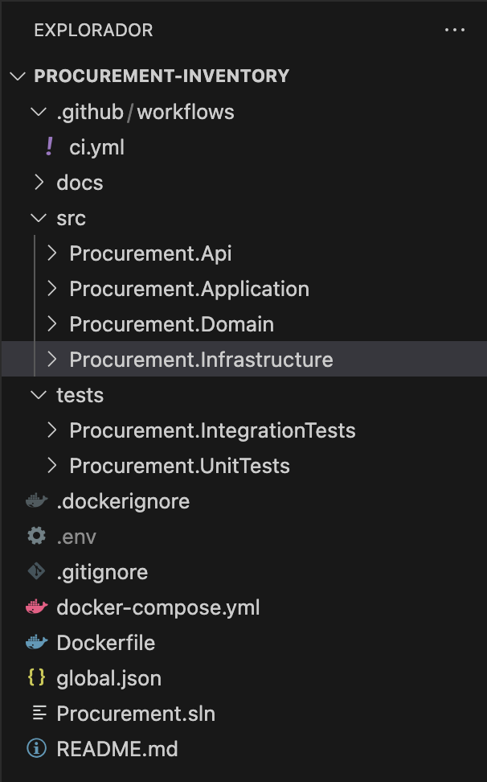
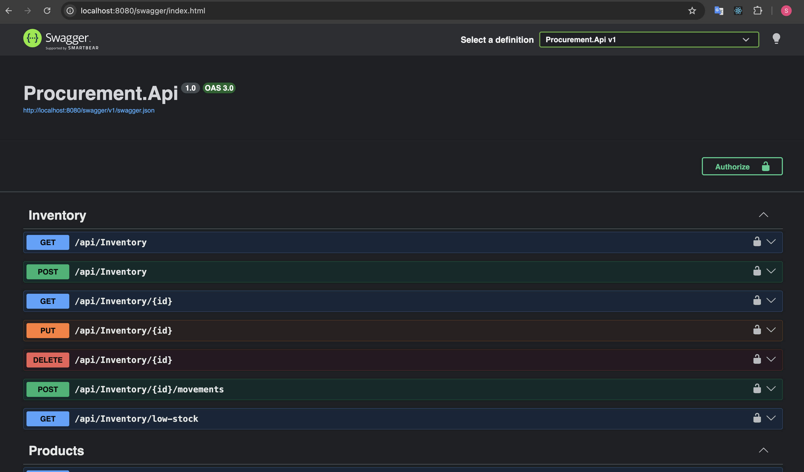
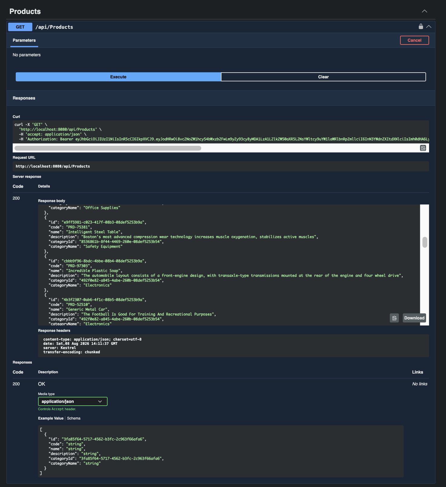
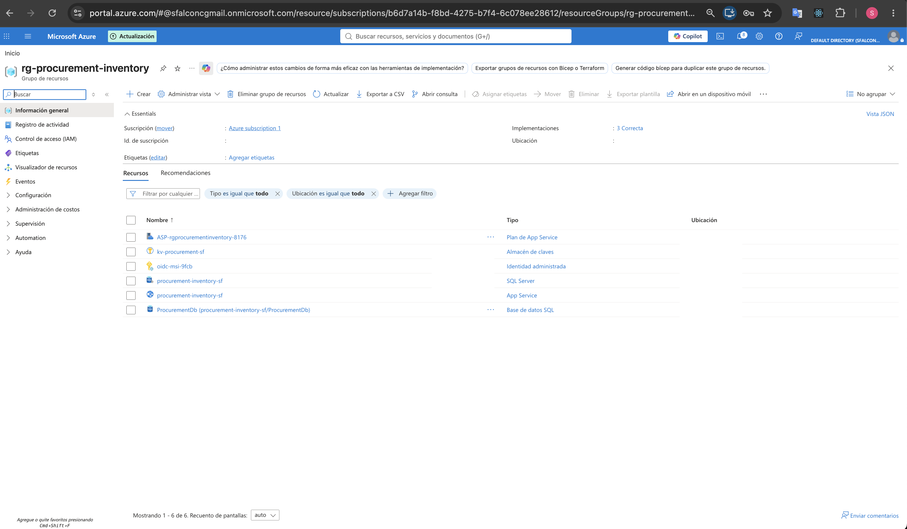
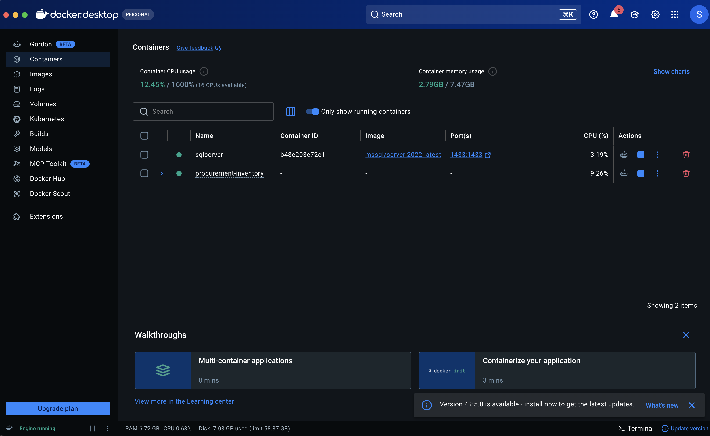
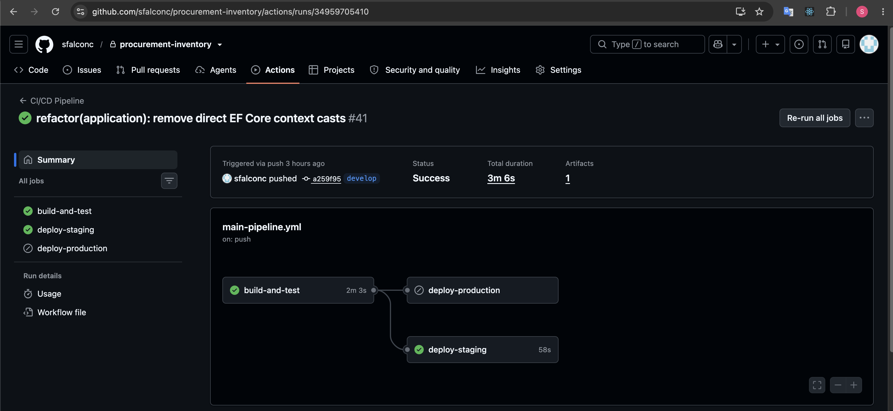

# Procurement And Inventory Management Platform

Backend platform for managing procurement and inventory processes, designed around a realistic enterprise application scenario. The project demonstrates the implementation of a production oriented .NET backend using modern architectural patterns, security practices, automated testing, containerization, and continuous integration (CI).

## Overview

The idea for this project came from researching the type of software commonly used in modern business environments, including enterprise platforms and solutions focused on internal processes such as procurement, inventory, logistics, and supplier management.

Based on that research, I chose procurement and inventory management as a representative business domain and designed the project as an environment to apply modern backend engineering practices, including architecture, security, testing, API design, containerization, and cloud oriented development.

This project corresponds to the MVP of a procurement and inventory management platform, conceived for small and medium sized businesses looking to digitalize processes that are commonly managed through spreadsheets and email. The implementation is structured as an evolving product, with the current version focusing on the core backend architecture and a subsequent V2 roadmap covering advanced architecture, cloud deployment, observability, background processing, and integration testing.

## Key Features

- Product and category management.
- Supplier management.
- Procurement and inventory domain modeling.
- Clean Architecture.
- CQRS with MediatR.
- Entity Framework Core.
- SQL Server.
- JWT-based authentication.
- Role-based and policy-based authorization.
- Secure password hashing with PBKDF2.
- Optimistic concurrency for inventory operations.
- Audit information for relevant entities.
- Unit and integration testing (using Bogus for test data).
- Docker containerization.
- GitHub Actions CI.
- Swagger / OpenAPI documentation.
- Health checks.
- Database migrations.

## Architecture

The solution follows Clean Architecture, separating business rules from infrastructure and delivery concerns.



### Main Layers

- **Procurement.Domain:** Contains the core business entities, enums, and domain rules.
- **Procurement.Application:** Contains use cases, commands, queries, DTOs, validation, interfaces, and application-level business orchestration.
- **Procurement.Infrastructure:** Contains persistence and infrastructure implementations, including Entity Framework Core, SQL Server integration, authentication related persistence, and database seeding.
- **Procurement.Api:** Exposes the application through HTTP APIs and contains authentication, authorization, middleware, Swagger configuration, health checks, and API composition.

## Technology Stack

| Technology                | Purpose                                  |
| ------------------------- | ---------------------------------------- |
| **.NET 8**                | Backend platform                         |
| **C#**                    | Programming language                     |
| **ASP.NET Core**          | Web API                                  |
| **Entity Framework Core** | ORM / data access                        |
| **SQL Server**            | Relational database                      |
| **MediatR**               | CQRS implementation                      |
| **JWT Bearer**            | Authentication                           |
| **PBKDF2**                | Password hashing                         |
| **xUnit**                 | Testing framework                        |
| **Bogus**                 | Fake data generation for testing/seeding |
| **Docker**                | Containerization                         |
| **Docker Compose**        | Local multi-container environment        |
| **Swagger / OpenAPI**     | API documentation                        |
| **GitHub Actions**        | Continuous Integration (CI)              |

## Authentication & Authorization

The API implements JWT-based authentication and role-based authorization using ASP.NET Core Authentication and Authorization.

### Authentication Flow

Authentication is handled through the following flow:

1. The client sends credentials to `POST /api/auth/login`.
2. The application retrieves the user by username.
3. The password is verified against the stored password hash.
4. A JWT is generated for valid credentials.
5. The client includes the JWT in subsequent requests using the `Authorization: Bearer <token>` header.
6. ASP.NET Core validates the token before allowing access to protected endpoints.

The authentication flow follows the project's Clean Architecture and CQRS structure:

```text
AuthController
      ↓
LoginCommand
      ↓
LoginCommandHandler
      ↓
User + Password Verification
      ↓
IJwtTokenGenerator
      ↓
JWT
```

### Login Endpoint

**POST** `/api/auth/login`

Request:

```json
{
  "username": "admin",
  "password": "Admin123!"
}
```

Successful response:

```json
{
  "token": "<JWT>"
}
```

_The returned JWT contains the authenticated user's identifier and role._

### Test User

A development/test user is created automatically through database seeding. The password is stored as an irreversible PBKDF2 hash and is never persisted as plain text.

| Field        | Value     |
| ------------ | --------- |
| **Username** | admin     |
| **Password** | Admin123! |
| **Role**     | Admin     |

_Note: The development credentials are intended only for local testing._

### Authorization

The API uses role-based authorization through ASP.NET Core policies. Available roles:

- Admin
- Purchaser
- Warehouse

Endpoints can require a specific role through the corresponding authorization policy (e.g., `RequireAdmin`, `RequirePurchaser`, `RequireWarehouse`). Authorization is enforced at the API layer.

- An authenticated user with an insufficient role receives `403 Forbidden`.
- A request without valid authentication receives `401 Unauthorized`.

### Swagger Authentication

Swagger UI can be used to test authenticated endpoints.

1. Open Swagger: `http://localhost:8080/swagger`
2. Execute `POST /api/auth/login`.
3. Copy the returned JWT.
4. Click **Authorize** at the top of the page.
5. Enter: `Bearer <JWT>` (The word Bearer must be included before the token).
6. Click **Authorize**.
7. Execute the protected endpoints. Swagger will automatically include the JWT in the Authorization header.





### Current User and Auditing

The application provides a `CurrentUserService` for accessing information about the authenticated user through `HttpContext`. Authenticated user information is used for auditing, including fields such as `CreatedBy`, `UpdatedBy`, and `UpdatedAt`.

## Security & Secrets Management

### JWT & Secrets Management Strategy

Authentication is implemented using JWT bearer tokens. The API validates the token issuer, audience, lifetime, and signing key.

JWT configuration is loaded through the standard .NET configuration pipeline. The signing key is intentionally excluded from source control and is not stored in `appsettings.json`.

The application uses environment-specific configuration for sensitive values:

- **Local Execution:** The API can run directly on the development machine using local configuration. Sensitive configuration is excluded from source control.
- **Docker:** Containerized local execution uses environment variables defined through `docker-compose.yml` and a local `.env` file. The `.env` file is excluded from source control.
- **Azure:** Azure Key Vault is added as a configuration provider during application startup when a `KeyVaultUri` is configured.
- **Authentication:** The application uses `DefaultAzureCredential()` to authenticate with Azure Key Vault. In Azure, the App Service uses a System-Assigned Managed Identity authorized through Azure RBAC.
- **Runtime Configuration:** Secrets retrieved from Key Vault become part of the application's standard configuration pipeline _before_ infrastructure services and JWT authentication are registered. This makes the resolved configuration available to services that require it during application startup and runtime.

## Cloud Deployment (Azure)

The application is deployed to Microsoft Azure using managed services for API hosting, relational data persistence, and secure secrets management.

### Azure Resources

- **Azure App Service:** Hosts the .NET 8 Web API.
- **Azure SQL Database:** Managed relational database for application data persistence.
- **Azure Key Vault:** Secure storage and runtime configuration of sensitive application secrets.

### Deployment Evidence

- **Live API (Swagger):** [Swagger UI - Procurement API](https://procurement-inventory-sf-bmawd3c2a7fuh4a0.southeastasia-01.azurewebsites.net/swagger/index.html)
- **Live Health Check:** [API Health Status](https://procurement-inventory-sf-bmawd3c2a7fuh4a0.southeastasia-01.azurewebsites.net/health)



## Testing, Authentication, and Authorization

The solution contains separate unit and integration test projects:

```text
tests/
├── Procurement.UnitTests
└── Procurement.IntegrationTests
```

- **Test Authentication Handler:** Integration tests use a dedicated `TestAuthenticationHandler` to isolate authorization behavior from the real authentication flow. The test authentication scheme can simulate authenticated users with different roles through the `X-Test-Role` header.
- **Data Generation:** The **Bogus** library is utilized to generate realistic fake data for unit tests, integration tests, and database seeding, ensuring robust and varied test scenarios.
- **Execution:** Run all tests with `dotnet test`.

## Running Locally

### Prerequisites

- .NET 8 SDK
- Docker Desktop
- Git

### Configuration

Environment specific configuration is provided through .NET User Secrets and environment variables. Required values:

- `ConnectionStrings__DefaultConnection`
- `JwtSettings__SecretKey`
- `JwtSettings__Issuer`
- `JwtSettings__Audience`
- `JwtSettings__ExpirationMinutes`

### Docker Compose

The local environment consists of the ASP.NET Core API and SQL Server.



Start the environment with:

```bash
docker compose up --build
```

- **API:** `http://localhost:8080`
- **Swagger:** `http://localhost:8080/swagger`
- **Health check:** `http://localhost:8080/health`

To stop the environment:

```bash
docker compose down
```

_SQL Server data is persisted through a Docker volume._

## CI (Continuous Integration)

The project uses GitHub Actions for continuous integration. The CI workflow restores dependencies, builds the solution, and executes the automated test suite.



## Development Practices

The project follows practices intended to keep the codebase maintainable as the application grows:

- Separation of concerns through Clean Architecture.
- CQRS for application use cases.
- Dependency inversion and explicit application interfaces.
- Automated unit and integration testing (utilizing Bogus).
- Role based and policy based authorization.
- Secure password hashing.
- Environment-based configuration and secure secret handling.
- Containerized local development.
- Automated CI validation.
- Database migrations and health checks.
- API documentation through OpenAPI / Swagger.

## Roadmap

The project is planned as an incremental evolution from the current MVP toward a more complete enterprise oriented platform.

### V2 — Advanced Architecture And Cloud

- **Domain Events and Notification Service:** Domain Events, MediatR Notifications, Notification Service, Low Stock Notifications, Purchase Order Events.
- **Background Processing:** Worker Service, BackgroundService, Scheduled Jobs, Inventory Monitoring, Reorder Alerts.
- **Azure Deployment:** Azure App Service, Azure SQL Database, Azure Key Vault, GitHub Actions Deployment.
- **Observability:** Serilog, OpenTelemetry, Correlation IDs, Structured Logging, Distributed Tracing.
- **Integration Testing with Testcontainers:** Testcontainers, SQL Server Container, Migration from SQLite In-Memory, Expanded integration test coverage.
- **Release V2.0.0:** Build validation, Automated tests, Documentation, Git tag, GitHub Release.

## License

This project is provided as a portfolio and demonstration project.
